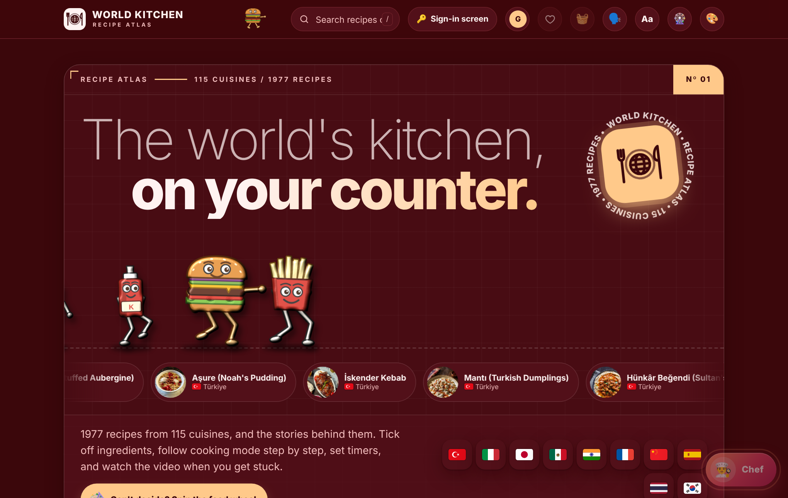
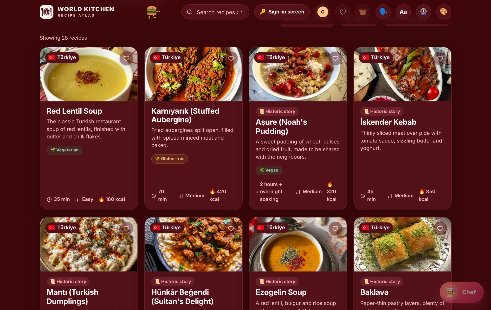
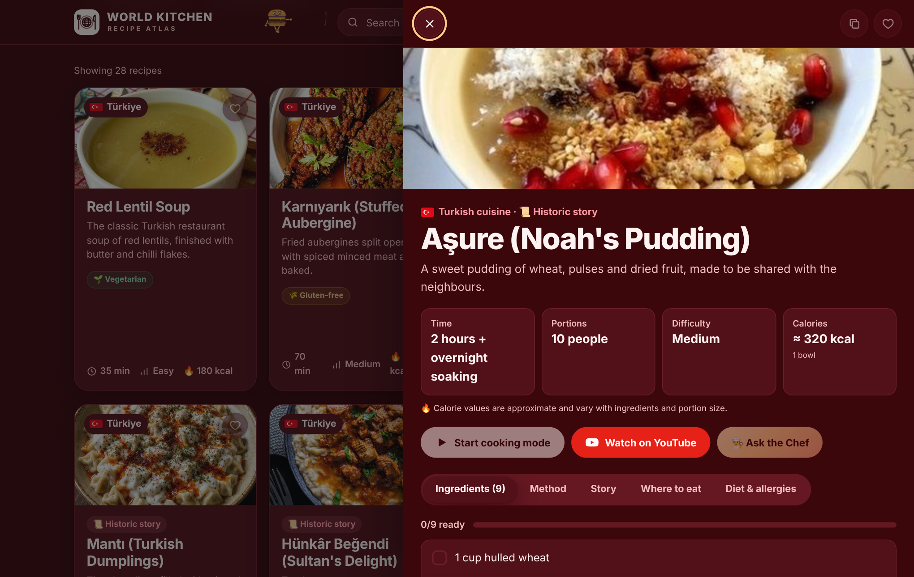
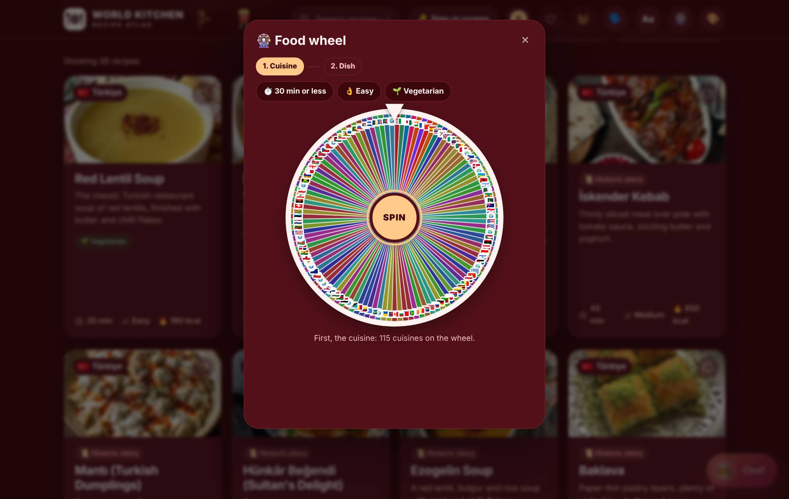
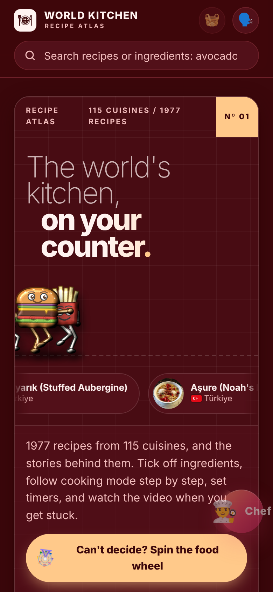

# Dünya Mutfağı (World Kitchen) – PHP sürümü

**Mustafa Çakmak – 254309252**

Dünya mutfaklarından tarifleri, hikâyeleriyle birlikte sunan bir tarif sitesi. Sitede **115 mutfaktan 1.977 tarif** var: 32 el yazımı tarif ve [Wikibooks Cookbook](https://en.wikibooks.org/wiki/Cookbook)'tan alınan yaklaşık 1.900 tarif. Site PHP ile sunulur, arayüzü İngilizcedir (World Kitchen).



## Projenin amacı
Evde elindeki malzemeyle ne pişireceğini bilmeyen ya da farklı ülkelerin mutfaklarını keşfetmek isteyen kişiye, tarifi tek ekranda adım adım pişirebileceği bir kaynak sunmak. Her tarifte malzemeler, yapılış, tarifin hikâyesi, nerede yenir bilgisi, diyet ve alerji bilgisi bulunur.

## Özellikler
- **Tarif kataloğu:** 115 mutfak; ülkeye, zorluk düzeyine ve kaynağa göre filtreleme, favoriler, arama
- **Tarif detayı:** Malzeme listesi (işaretlenebilir), yapılış adımları, hikâye, "Nerede yenir?", diyet ve alerji sekmeleri
- **Pişirme modu:** Adım adım ekran, zamanlayıcı, sesli okuma
- **Elimde ne var?:** Seçilen malzemelere göre yapılabilecek tarifleri ve eksikleri gösterir
- **Yemek çarkı:** Önce mutfak, sonra yemek seçtiren iki aşamalı çark (süre, zorluk, vejetaryen filtreli)
- **Şef:** Soru-cevap ve sesli sohbet asistanı
- **Hesap sistemi:** Kullanıcı adı, e-posta veya Google ile giriş; favoriler, notlar, rozetler
- **Kişiselleştirme:** 19 tema, sesli okuma ayarları
- **Animasyonlar:** Açılan pencereler, tarif paneli, pişirme modu, kartlar ve başlıktaki hamburger-patates kovalama sahnesi (bilgisayarında "hareketi azalt" ayarı açıksa kapanır)
- **Mobil uyumlu:** Telefon ekranına göre düzenlenir

| Tarif listesi | Tarif detayı |
|---|---|
|  |  |

| Yemek çarkı | Mobil görünüm |
|---|---|
|  |  |

## Kullanılan teknolojiler
- **PHP 7.4+** – sayfa iskeleti, ayarlar, büyük veri dosyalarının sunumu (`data.php`)
- **HTML, CSS, JavaScript** (kütüphanesiz)
- **Supabase Auth** – e-posta ve Google ile giriş
- **Wikibooks Cookbook** (CC BY-SA 4.0) ve **Wikimedia Commons** – tarifler ve fotoğraflar

## Kurulum ve çalıştırma
PHP dosyaları çift tıklayarak açılmaz, bir sunucu üzerinden çalışır.

### XAMPP ile (Windows)
1. Bu klasörü `C:\xampp\htdocs\dunya-mutfagi` olarak kopyalayın.
2. XAMPP Control Panel'den **Apache**'yi başlatın.
3. Tarayıcıda `http://localhost/dunya-mutfagi/` adresini açın.

### PHP yerleşik sunucusuyla
```bash
php -S localhost:8000
```
Sonra `http://localhost:8000` adresini açın. Ek eklenti gerekmez (`zlib` varsa veri dosyaları sıkıştırılır).

> Yazı tipleri ve tarif fotoğrafları internetten yüklendiği için sunum yapılan bilgisayarın internete bağlı olması gerekir.

## Proje yapısı
```
index.php            Sayfa iskeleti: parçaları, ayarları ve betikleri birleştirir
config.php           Ayarlar (SITE_URL, Supabase, analytics) ve yardımcı işlevler
data.php             Büyük veri kümelerini (?set=wb|flags|embed) önbellekli JS olarak sunar
gizlilik.php         Gizlilik sayfası
kosullar.php         Koşullar sayfası
partials/            <head>, sayfa gövdesi ve yasal sayfa parçaları
assets/css/          Stiller (main, auth, tweaks, motion, legal)
assets/js/           app.js (uygulama), motion.js (animasyon yardımcıları), hero.js (başlık animasyonu)
data/                Wikibooks tarifleri, bayraklar, gömülü fotoğraflar (JSON)
docs/                Ekran görüntüleri, tanıtım videosu metni, teslim kontrol listesi
```

## Ayarlar
`config.php` içindeki değerler ortam değişkenleriyle değiştirilebilir:

| Değişken | Anlamı | Varsayılan |
|---|---|---|
| `SITE_URL` | Sitenin adresi (paylaşım etiketleri için) | `https://dunya-mutfagi.vercel.app` |
| `SUPA_URL`, `SUPA_KEY` | Supabase projesi ve herkese açık "anon" anahtarı | proje değerleri |
| `SUPA_GOOGLE` | Google ile giriş düğmesi | `true` |
| `VERCEL_ANALYTICS` | Vercel Web Analytics (yalnızca Vercel'de çalışır) | `false` |

Google ile girişin çalışması için Supabase'de izin verilen adreslere sitenin adresi (ör. `http://localhost`) eklenmelidir.

## Tanıtım videosu
Projenin amacını ve özelliklerini anlatan kısa video: [docs/tanitim-videosu.mp4](docs/tanitim-videosu.mp4) (GitHub'da dosyaya tıklayınca oynatılır).

## Yedek
Projenin güncel ZIP yedeği (Google Drive): [dunya-mutfagi-guncel.zip](https://drive.google.com/file/d/1TCjSFuhMDLCvtFWsrK4nA0Xfi49wUhvZ/view?usp=sharing)

## Diğer sürüm
Sitenin tek dosyalık HTML sürümü ve dönem projesi raporları: [Mustafa-Cakmak-254309252](https://github.com/Mstf12344/Mustafa-Cakmak-254309252). Yayındaki HTML sürümü: https://dunya-mutfagi.vercel.app

## Lisans ve kaynaklar
Wikibooks tarif metinleri [Wikibooks Cookbook](https://en.wikibooks.org/wiki/Cookbook) yazarlarına aittir ve [CC BY-SA 4.0](https://creativecommons.org/licenses/by-sa/4.0/deed.tr) lisansıyla paylaşılır; her tarifin "Story" sekmesinde kaynak sayfası bağlantısı verilir. Fotoğraflar Wikimedia Commons'tandır, her birinin yazarı ve lisansı tarifin yanında gösterilir. Sitenin kodu ve kendi 32 tarifi bu lisansın dışındadır.
